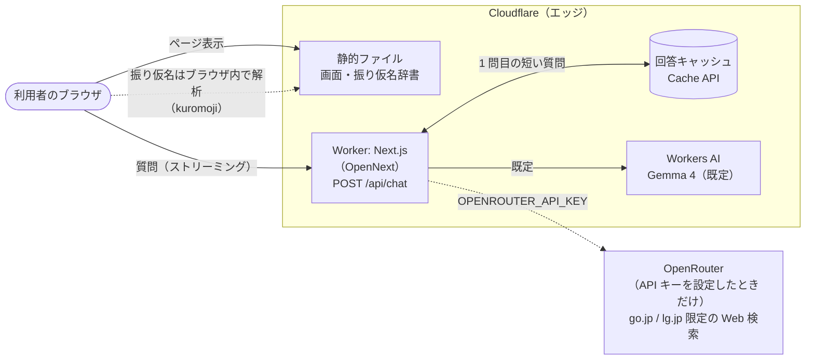
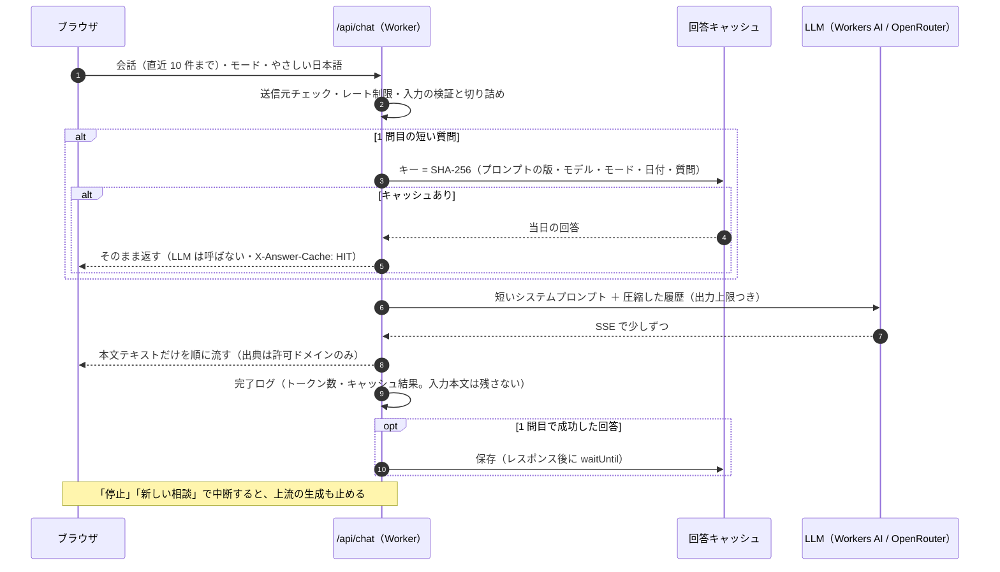
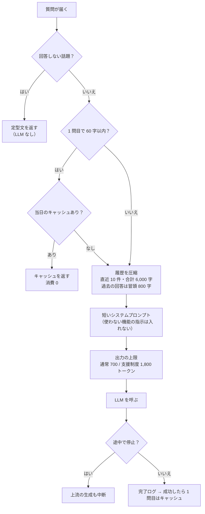
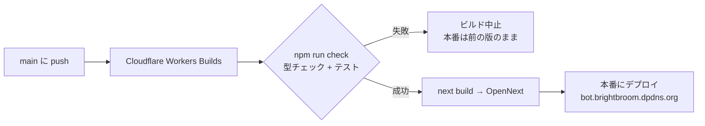

# BrightBroom Bot（chat-bot）

行政手続きや公的制度について相談できる、公開の行政相談チャットボットです。BrightBroom が運営しています。

**公開中: https://bot.brightbroom.dpdns.org**

[チームみらい](https://github.com/team-mirai) の [mirai-gbot](https://github.com/team-mirai/mirai-gbot) をフォークして改変したものです（ライセンスは同じ AGPL-3.0-or-later）。

Next.js (App Router) + TypeScript のチャットボットで、回答は [Cloudflare Workers AI](https://developers.cloudflare.com/workers-ai/) の LLM（既定は Google Gemma 4）で生成します。API キーは不要で、Workers AI の無料枠（1 日 10,000 Neurons）の範囲なら無料で動きます。[Cloudflare Workers](https://developers.cloudflare.com/workers/) 上で [OpenNext](https://opennext.js.org/cloudflare) を使って動かしています。

## ローカルで動かす

```bash
npm install
npx wrangler login   # Workers AI はローカルからも Cloudflare 上で実行されるため、ログインが必要
npm run dev
```

http://localhost:3000 を開きます。

Cloudflare の実行環境（workerd）で確認したいときは:

```bash
cp .dev.vars.example .dev.vars   # 必要な設定だけ記入（空でも動く）
npm run preview                  # http://localhost:8787
```

## Cloudflare にデプロイ

設定は `wrangler.jsonc`（Worker 名 `chat-bot`）と `open-next.config.ts` にあります。

### GitHub 連携（Workers Builds、推奨）

GitHub Actions の実行枠を使わずに、Cloudflare 側でビルド・デプロイします。

1. Cloudflare ダッシュボードの **Workers & Pages → Create → Import a repository** でこのリポジトリを選ぶ
2. ビルド設定
   - Build command: `npx opennextjs-cloudflare build`
   - Deploy command: `npx opennextjs-cloudflare deploy`
3. 任意の設定値があれば、Worker の **Settings → Variables and Secrets** に追加（Workers AI を使うだけなら不要）
4. デプロイすると `https://chat-bot.<アカウント>.workers.dev` で公開される

以降は `main` への push で本番が自動デプロイされます。

### 手元から直接デプロイ

```bash
npx wrangler login
npm run deploy
```

## 構成

- `app/page.tsx` — チャット画面（クライアントコンポーネント）。回答の途中で止める「停止」、回答の「コピー」、エラー時の「もう一度送る」、支援制度モードの「この内容で制度を案内して」、過去の回答を読んでいるときの「最新の回答へ」があります。入力欄は複数行で、パソコンでは Enter で送信・Shift+Enter で改行（日本語入力の確定では送信しない）。画面上部で文字サイズ（標準・大・特大）と「やさしい日本語」モードを切り替えられます（設定はブラウザに保存）
- `app/useSpeechRecognition.ts` — ブラウザの Web Speech API による日本語の音声入力。対応ブラウザ（Chrome・Edge・Safari など）でのみ入力欄にマイクボタンが表示されます
- `app/api/chat/route.ts` — チャット API の入口。検証 → レート制限 → プロンプト組み立て → LLM 呼び出し → ストリーミング返却の流れだけを書き、処理の中身は `lib/chat/` に分けています（下の「コードの構成」参照）
- LLM: 既定は Cloudflare Workers AI の `@cf/google/gemma-4-26b-a4b-it`（`wrangler.jsonc` の `ai` バインディング）。環境変数 `WORKERS_AI_MODEL` で別のモデル（例: `@cf/zai-org/glm-4.7-flash`）に変えられます
  - 費用: Workers AI は 1 日 10,000 Neurons まで無料（毎日 0 時 UTC にリセット）。1 往復あたり数十 Neurons 程度なので、1 日数百回の会話までは無料枠に収まる見込みです。**Workers の無料プランなら、無料枠を超えた分はエラーになるだけで課金されません**（有料プランでは超過分が $0.011 / 1,000 Neurons で課金）
  - Workers AI では Web 検索をしないため、出典リンクは付きません。金額や期限は公式サイト・窓口で確認するよう案内します
  - `OPENROUTER_API_KEY` を設定すると OpenRouter に切り替わり、政府・自治体サイトに限定した Web 検索と出典表示が使えます（モデルは `OPENROUTER_MODEL`、既定 `openai/gpt-6-luna`）
- 振り仮名: 画面右上のスイッチで、漢字に振り仮名（HTML の `<ruby>` 要素）を付けて表示できます。読みは形態素解析ライブラリ [kuromoji](https://github.com/takuyaa/kuromoji.js) を使って**ブラウザ上で**求めます（`app/Furigana.tsx` / `lib/furigana-core.ts`、外部 API は使いません）。辞書（約 17MB）は Worker に同梱できないため、ビルド時に `public/kuromoji-dict/` へコピーして静的ファイルとして配り、振り仮名を初めてオンにしたときだけ読み込みます
- 支援制度を探す（AI インタビュー）: 最初の画面の「使える支援制度を探す」ボタンで開始。ボットが困りごと・世帯構成・市区町村・収入の目安などを一問ずつ聞き取り、利用できそうな給付・手当・減免・貸付・相談窓口を、申請先・期限・出典つきで一覧表示します。氏名や詳しい住所などの個人情報は聞きません。API には `mode: "support"` を付けて送り、専用のシステムプロンプトに切り替えます
- 回答しない話題: `lib/chat/blocked.ts` に名前（表記ゆれは正規化して比較）を登録すると、その人物についての質問には LLM を呼ばずに定型の断り文を返します。間接的に指す質問用の指示文も `BLOCKED_TOPIC_RULE` に書けます。既定では何も登録していません
- Web 検索（OpenRouter 利用時のみ）: OpenRouter の web プラグインで最新情報を検索した上で回答します。検索対象は政府・自治体の公式ドメイン（`go.jp` / `lg.jp` とそのサブドメイン）だけに限定しており、それ以外のサイトは検索・出典表示の対象になりません。対象ドメインは `SEARCH_ALLOWED_DOMAINS`（カンマ区切り）で変更できます。参照したページは回答末尾に出典として表示されます。`OPENROUTER_WEB_SEARCH=false` で無効化できます（検索 1 回あたり追加コストがかかります）

## 全体の仕組み



### 質問が届いてから回答を返すまで



## LLM の消費を抑える工夫

Workers AI の無料枠（1 日 10,000 Neurons）を長く使えるよう、トークンを使う場所ごとに対策しています。入力（システムプロンプトと履歴）が費用の大半を占めるので、そこを中心に削っています。



| 対策 | 内容 | 効果の目安 |
| --- | --- | --- |
| システムプロンプトの圧縮 | 重複した指示を削り、Web 検索がないときは検索の指示を入れない。安全に関わる指示（緊急時の窓口・個人情報）は残す | 通常 1,795 → 833 字（-54%）、支援制度 2,512 → 1,479 字（-41%）。毎回の入力に効く |
| 履歴の圧縮 | 送る履歴を直近 10 件・合計 6,000 字に。過去の回答は冒頭 800 字だけ | 長い会話ほど効く（以前は 20 件・12,000 字） |
| 出力の上限 | 通常の相談は 700、支援制度の一覧は 1,800 トークン | 長すぎる回答での消費を防ぐ |
| 回答キャッシュ | 1 問目の短い質問は、同じ日・同じ設定の回答を Cloudflare のエッジキャッシュから返す。トップの「よくある質問」や「使える支援制度を探す」の 1 問目が当たる | 当たれば消費 0 で、表示も一瞬 |
| 中断の伝播 | 「停止」「新しい相談」や画面を閉じたとき、LLM の生成も止める | 読まれない回答の生成をしない |
| 計測 | 1 回ごとに入出力トークン数・キャッシュの当たり外れを構造化ログに出す（`chat.completed`） | Cloudflare の Workers Logs で効果を確認できる |

上限値は環境変数（`MAX_HISTORY_MESSAGES` / `MAX_HISTORY_CHARS` / `MAX_ASSISTANT_CHARS` / `MAX_OUTPUT_TOKENS_CHAT` / `MAX_OUTPUT_TOKENS_SUPPORT`）で変えられます。プロンプトを変えたら `lib/chat/prompts.ts` の `PROMPT_VERSION` を上げてください（古いキャッシュを使わなくなります）。プロンプトの文字数はテストで上限を見張っています。

## コードの構成

```
app/
  api/chat/route.ts      POST /api/chat（各モジュールをつなぐだけの薄い層）
  page.tsx               チャット画面
  Furigana.tsx / Markdown.tsx / useSpeechRecognition.ts
lib/
  chat/
    config.ts            環境変数の読み取り（リクエストごとに読む）
    request.ts           リクエスト本文の検証
    guard.ts             入力の上限・クロスサイト拒否・レート制限（RateLimiter）
    prompts.ts           システムプロンプトの組み立て（純粋関数）
    sse.ts               LLM の SSE 応答 → 本文テキストのストリーム（出典の付与）
    domains.ts           検索・出典に使ってよいドメインの判定
    blocked.ts           回答しない話題
    log.ts               構造化ログ（JSON 1 行。利用者の入力は出さない）
    cache.ts             1 問目の回答キャッシュ（Cloudflare Cache API）
    llm/                 LLM の呼び出し先（共通インターフェース ChatProvider）
      workers-ai.ts      Cloudflare Workers AI（既定）
      openrouter.ts      OpenRouter（OPENROUTER_API_KEY があるとき。Web 検索つき）
  client/chat-stream.ts  ブラウザ側のストリーミング受信（中断対応）
  client/useStickToBottom.ts  チャットのスクロール制御
app/chat/
  Composer.tsx           入力欄（複数行・Enter 送信・IME 対応・停止ボタン）
  MessageActions.tsx     回答の操作（コピー・もう一度送る）と回答待ちの表示
  furigana-core.ts       振り仮名の付与ロジック
tests/                   Vitest のユニットテスト
```

### テストとチェック

```bash
npm run check   # 型チェック（tsc）＋ユニットテスト（Vitest）
npm test        # テストだけ
```



`npm run build` の前に `npm run check` が自動で走るため、型エラーやテストの失敗があると Cloudflare のビルド（Workers Builds）も止まり、本番には出ません。GitHub Actions は使っていません。

## セキュリティ

アプリ側で行っている対策:

- `/api/chat` の入力検証: 文字列以外の content を拒否、1 メッセージ 2000 文字・履歴 20 件・本文 64KB まで（下記「不正利用・コスト対策」の環境変数で変更可）
- IP ごとの簡易レート制限（既定 10 回/分・100 回/日）
- 他サイトからのブラウザ経由の呼び出し（`Sec-Fetch-Site: cross-site` / Origin 不一致）を拒否
- LLM（Workers AI / OpenRouter）のエラー詳細はクライアントに返さずサーバーログのみに出す
- Workers AI は入力をモデルの学習に使わない。OpenRouter 利用時は `provider.data_collection: "deny"` を指定し、入力を学習・保存するプロバイダーを使わない
- CSP・`X-Frame-Options`・HSTS などのセキュリティヘッダー（`next.config.ts`）
- Markdown 表示は innerHTML を使わず、リンクは http(s)/mailto のみ許可

運用側で設定してください（コードでは防ぎきれないもの）:

- **Workers の無料プランのまま使う**か、有料プランなら Workers AI の使用量を確認する（無料プランなら無料枠超過はエラーになるだけで課金されない）。OpenRouter を使う場合は **API キーに利用上限（クレジット上限）を設定**する。`/api/chat` は認証なしの公開エンドポイントなので、上限が最後の砦になります
- **Cloudflare の WAF でレート制限ルールを追加**する（例: `/api/chat` に IP あたり 10 回/分）。アプリ内のレート制限はアイソレートごとのメモリなので完全ではありません。WAF のルールは独自ドメイン（Cloudflare に追加したゾーン）で配信する場合に使えます
- 必要なら Bot Fight Mode や Cloudflare Turnstile を有効にする

## 不正利用・コスト対策

`/api/chat` は 1 回ごとに LLM の利用量（Workers AI の Neurons、または OpenRouter の従量課金）を消費するため、次の制限を入れています（`lib/chat/config.ts` で読み込み、`lib/chat/guard.ts` で適用）。値は環境変数で変更でき、`0` で無効になります。

| 環境変数 | 既定値 | 内容 |
| --- | --- | --- |
| `RATE_LIMIT_PER_MINUTE` | 10 | IP あたり 1 分間のリクエスト上限。超えると 429 |
| `RATE_LIMIT_PER_DAY` | 100 | IP あたり 1 日のリクエスト上限。超えると 429 |
| `MAX_INPUT_CHARS` | 2000 | 1 メッセージの最大文字数。超えると 400 |
| `MAX_HISTORY_MESSAGES` | 10 | モデルに送る会話履歴の最大件数（古い分は切り捨て） |
| `MAX_HISTORY_CHARS` | 6000 | モデルに送る会話履歴の合計最大文字数（古い分は切り捨て） |
| `MAX_ASSISTANT_CHARS` | 800 | 履歴として送る過去の回答 1 件あたりの最大文字数（冒頭だけ送る） |
| `MAX_OUTPUT_TOKENS_CHAT` | 700 | 通常の相談の 1 回の出力上限（トークン） |
| `MAX_OUTPUT_TOKENS_SUPPORT` | 1800 | 支援制度モードの 1 回の出力上限（トークン） |
| `WORKERS_AI_MODEL` | `@cf/google/gemma-4-26b-a4b-it` | Workers AI のモデル |

レート制限のカウンタはサーバーのメモリ上に持っているため、Cloudflare Workers のように複数のアイソレートで動く環境や再起動後はカウントが分散・リセットされます。あくまで目安の上限なので、**確実な上限として OpenRouter 側でも利用上限を設定してください**。

### OpenRouter の利用上限を設定する（OpenRouter を使う場合）

1. [OpenRouter の Keys ページ](https://openrouter.ai/settings/keys) で本番用の API キーを開き（または新しく作成し）、**Credit limit** に上限額（例: 月の予算）を設定する
2. 上限に達するとそのキーでのリクエストは失敗するので、ボットはエラーを返して止まり、それ以上は課金されない
3. 自動チャージ（Auto top-up）を使う場合は、チャージ額・上限も予算に合わせておく
4. [Activity ページ](https://openrouter.ai/activity) で利用状況を定期的に確認する

さらに強い対策が必要になった場合は、Cloudflare WAF のレート制限ルールや Bot 対策（Bot Fight Mode）、Cloudflare Turnstile の導入を検討してください。

## 元プロジェクトからの主な変更点

- ボットの名前・運営者を BrightBroom Bot / BrightBroom に変更（`lib/chat/prompts.ts` の自己紹介情報、画面のロゴ、タイトル）
- ロゴ（ツバメ）とキャラクター「ブルーム」（ツバメ、`public/bot-avatar.webp`。Google Gemini で生成）を新しく作成（元のロゴとキャラクター画像は使っていません）
- 元プロジェクト固有の回答 NG 人物の指定を削除（仕組みは残しています）
- トップのプロトタイプ告知（YouTube 配信へのリンク）を削除
- Issue 自動実装・コンフリクト自動解決の GitHub Actions を削除
- ブラウザ保存キーの接頭辞を `bb-chat-bot:` に変更
- LLM の既定を OpenRouter から Cloudflare Workers AI（無料枠あり・API キー不要）に変更。OpenRouter はキーを設定したときだけ使う
- 公開先を Vercel から Cloudflare Workers（OpenNext）に変更。振り仮名の解析をサーバーからブラウザへ移動、クライアント IP は `cf-connecting-ip` を優先

## ライセンス

[GNU Affero General Public License v3.0 or later](LICENSE)（AGPL-3.0-or-later）で公開しています。

AGPL のため、このソフトウェアを改変してネットワーク越しにサービスとして提供する場合は、利用者に対して改変後のソースコードを入手できる手段を提供する必要があります。このリポジトリ（https://github.com/bright-broom/chat-bot）を公開しておくことで、その条件を満たしています。

Copyright (C) チームみらい（mirai-gbot の原著作者）  
Copyright (C) 2026 BrightBroom（改変部分）
